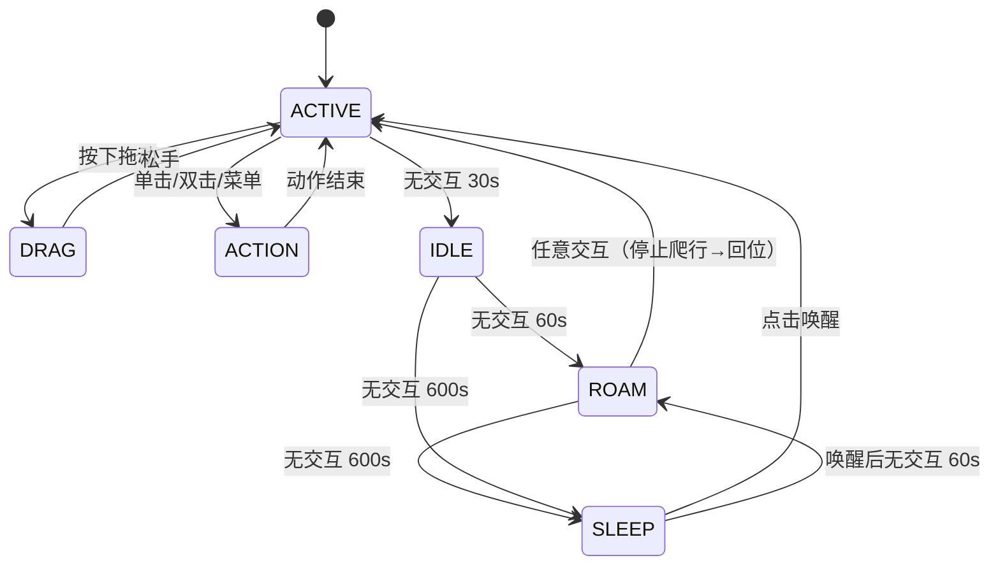

# 鲸鱼娘桌宠 · 二期开发计划书

| 项目 | 内容 |
|------|------|
| 文档版本 | v1.1 |
| 日期 | 2026-10-17 |
| 对象工程 | `whalechan-desktop-pet-dfy`（Electron 跨平台版） |
| 基线版本 | `1.0.0`（已产出 Windows NSIS 安装包） |
| 目标版本 | `2.0.0` |

> **【批注说明 · 2026-10-18】**
> 本文件中以「**【批注 · 小游戏接入】**」开头的段落，以及新增的「需求 5」「M2.5 / M4.5」等内容，
> 均为 **LomiVeku**（项目所有者）于 2026-10-18 提出的新增需求，由 WorkBuddy / DeepSeek 起草，
> **不属于 v1.1 原计划**。原计划正文一字未改，批注以引用块形式附在各节之后，便于交接时区分。
> 配套文档：`docs/GAME-PROTOCOL.md`（小游戏接入计划书）、`docs/TODO-BRIDGE.md`（待办对接需求）、
> `docs/WALLET-CONTRACT.md`（经济层约定）。

---

## 一、现状基线（As-Is）

在动手之前，先明确当前工程**已经有什么、缺什么**，避免重复建设。

### 1.1 已具备能力

| 模块 | 现状 | 位置 |
|------|------|------|
| 窗口 | 260×330 透明、无边框、`alwaysOnTop:true`、`skipTaskbar:true`、不进 Dock（`app.dock.hide()` 运行时隐藏） | `main.js:8-36` |
| 定位 | 固定右下角 `screen.getPrimaryDisplay().workAreaSize` | `main.js:29-30` |
| 拖拽 | **渲染层判定 + 主进程增量定位**：左键位移 > 5px 判定拖动；主进程以 drag-begin 时的窗口位置与光标位置为基准按增量 `setPosition`（delta 定位，不假设尺寸/DPI、跨次不累积）。"拎起"形象（`raise.png`）由 JS 切换 | `src/whalechan.html`（pointer 判定）、`main.js`（`wc:drag-begin/end` + 增量轮询）、`preload.js`（dragBegin/dragEnd 桥接） |
| 表现层 | 13 张透明 PNG 姿势精灵 + CSS `bob` 呼吸 + 气泡 + 米饭粒子 | `src/whalechan.html`、`src/sprites/*.png` |
| 状态机 | `locked` / `sleeping` / `actionTimer` / `idleTimer`，闲置 **50s** → `sleep.png` | `whalechan.html:155-214` |
| 菜单 | 托盘菜单与**宠物本体右键菜单共用 `buildPetMenu()` 同一模板**（说点什么 / 喂饭 / 切换姿势 / 鼠标穿透 / 退出）；已移除 `m.items[4].label` 硬编码写法 | `main.js`（`buildPetMenu` / `wc:context-menu`） |
| 透明区穿透 | **逐像素点击穿透**：按精灵 alpha 遮罩判定，只有角色不透明像素接收鼠标，透明空白自动放行给下层窗口（解决空白区挡点击） | `src/alpha-masks.js`（`make_alpha.py` 生成）、`whalechan.html`（查表 + `setIgnoreMouse`）、`main.js`（`applyIgnoreMouse`） |
| 打包 | `package.json` 三脚本 + `package.js` 自动识别平台 + `start.bat` | 根目录 |

#### 1.1.1 关键演进与已知问题（截至 2026-10-17）

- **拖拽（已解决，用户实测通过）**：演进路径 ① 主进程轮询 `screen.getCursorScreenPoint()` 绝对定位 → ② 渲染层发 `e.screenX/Y` 绝对定位 → ③ 原生 `-webkit-app-region: drag` → ④ **当前方案**：渲染层判定（左键位移 > 5px 才开始拖动）+ 主进程以 drag-begin 时的「窗口位置 & 光标位置」为基准、按光标位移增量 `setPosition`（delta 定位，不假设窗口尺寸/DPI，跨次不累积）。弃用 ③ 的原因：原生拖拽区会吞掉全部鼠标事件，导致 `click` / `contextmenu` 失效。
- **透明空白区挡点击（已解决）**：窗口为 260×330 矩形而角色只占一部分，透明区仍参与系统命中。已实现**逐像素点击穿透**（alpha 遮罩查表 + `setIgnoreMouseEvents`），空白处点击直接落到下层窗口。
- **本机 Electron 运行时版本错位**：`node_modules/electron/dist` 实际为 `v24.22.0`，而 `package.json` 声明 `^44.8.0`（旧缓存所致）。本机出包按 24.22.0 运行，Mac 端构建会按 44.8.0 重新拉取、不受影响。
- **旧构建目录被系统持锁**：`.electron-dist` / `dist-*` / `release` 等 8 个目录被 Windows Defender 实时扫描持锁（EBUSY），已登记"重启时移出项目"，重启一次即可彻底清理（已在 `.gitignore`）。

### 1.2 关键缺口（本计划书的靶点）

1. **无窗口右键菜单** —— 所有操作都要去点托盘，与宠物本体脱节。
2. **置顶不可控** —— 虽设了 `alwaysOnTop`，但等级为默认 `floating`，会被部分全屏应用/置顶窗口盖住；且用户无法临时取消。
3. **无单实例锁** —— 连点两次可启动多个桌宠，互相重叠。
4. **位置不持久化** —— 每次启动都回到右下角；拖动到副屏后重启会"消失"在屏幕外。
5. **无开机自启开关**。
6. **macOS 打包不完整** —— 缺 `LSUIElement`（Dock 隐身为运行时隐藏，仍有闪现）、缺 dmg 定制、无签名/公证方案。
7. **无 CI 双平台构建** —— Mac 包必须在 Mac 上打，本机 Windows 还受 Electron 解包文件锁（EPERM）困扰。
8. **表现层是"硬切图"** —— 换姿势靠 `img.src` 直接换文件，无中间帧、无呼吸/眨眼/物理，观感上限低。
9. **闲置行为单一** —— 只有一个 50s 睡眠，无中间态、无主动行为。
10. **单角色硬编码** —— `src/sprites/` 与状态机里的 `SPRITES` 数组强绑定，无法换角色。

---

## 二、目标与范围（To-Be）

### 2.1 总目标

把桌宠从「**会换图的置顶窗口**」升级为「**有性格、可换装、双平台可分发、有骨骼动画的桌面伙伴**」。

### 2.2 需求清单（按用户编号）

| 编号 | 需求 | 性质 | 风险 |
|------|------|------|------|
| **0** | 右键菜单 + 钉在桌面最上层 | 交互增强 | 低 |
| **1** | 完成 mac / win 代码与打包基础工 | 工程化 | 低-中 |
| **2** | 静态图 → Live2D | **表现层重构（最大工程量）** | **高（含授权）** |
| **3** | 闲置事件：1 分钟满屏爬 / 10 分钟睡眠 Live2D | 行为系统 | 中 |
| **4** | 多角色 + 收集/制作对应 Live2D | 资源体系 | **高（含授权与美术产能）** |

### 2.3 明确不做（本期范围外）

- 语音合成 / 语音唤醒
- 联网 AI 对话（宠物回复仍为本地台词库）
- 移动端 / 网页版
- 付费商店与在线角色分发

---

## 三、总体架构演进

### 3.1 分层重构

一期问题是**表现、行为、窗口三件事揉在 `whalechan.html` 里**。二期引入中间层：

```
┌─────────────────────────────────────────────┐
│ 主进程 main.js                                │
│  · 窗口与置顶等级    · 右键/托盘菜单（共用模板） │
│  · 单实例锁          · 位置持久化 state.json   │
│  · 开机自启          · 爬屏驱动（角色为窗口）   │
│  · 多显示器/工作区   · 光标全局坐标下发        │
└───────────────▲─────────────────────────────┘
                │ IPC（contextBridge 白名单）
┌───────────────┴─────────────────────────────┐
│ 渲染进程 whalechan.html                       │
│  ┌──────────────┐   ┌──────────────────────┐ │
│  │ BehaviorFSM  │──▶│ Animator 抽象接口     │ │
│  │ 活跃/闲置/爬行 │   │ ├ Live2DAnimator     │ │
│  │ /睡眠/临时动作 │   │ └ SpriteAnimator(兜底)│ │
│  └──────────────┘   └──────────────────────┘ │
│  ┌──────────────────────────────────────────┐│
│  │ CharacterHub：扫描/加载/切换/释放角色模型  ││
│  └──────────────────────────────────────────┘│
└─────────────────────────────────────────────┘
```

**核心设计原则：行为与表现解耦。** 行为层只说 `animator.play('run')`，具体是切 PNG 还是播 Live2D 动作由 Animator 决定。这样**需求 3 可以先用现有 PNG 落地（快速见效），需求 2 完成后再无痛切换到 Live2D**，两者不互相阻塞。

> **【批注 · 小游戏接入】对 3.1 分层重构（发起人：LomiVeku）**
>
> 本节的两层结构（主进程 / 渲染进程）需要加**第三块：游戏宿主**，与「行为层」「表现层」并列：
>
> ```
> 主进程
>  ├─ 窗口与置顶 · 菜单 · 持久化
>  ├─ 经济层 wallet（白饭/心情/胖度，唯一账本）
>  └─ 游戏宿主 game-host（开窗口、配沙箱、结算校验）
> 渲染进程（桌宠本体）
>  └─ BehaviorFSM → Animator
> 独立窗口（不可信）
>  └─ 小游戏（沙箱内，只能调 PetGame）
> ```
>
> 两个直接影响：
>
> 1. **`Animator` 抽象要提前到 M2.5 之前落地**。小游戏通过 `PetGame.react('happy')` 让桌宠做反应，
>    这条调用最终要落到 `animator.play('happy')`。如果先定 SDK 再定 Animator，等于让协议迁就实现。
> 2. **经济层与 `state.json` 分离**。`state.json`（M1）管窗口/开关，`wallet.json` 管余额，
>    两者写盘频率差一个数量级，合并会互相覆盖。

### 3.2 状态机（行为层）



**优先级**：`DRAG > ACTION > 用户交互 > ROAM > SLEEP`。高优先级事件到达时，低优先级行为**立即终止并回收资源**，同时重置 `lastInteractionAt`。

### 3.3 计时器重构（重要）

一期用散落的 `setTimeout` + 到处 `clearTimeout(idleTimer)`，**极易漏清导致状态打架**。二期改为**单一心跳**：

```js
let lastInteractionAt = Date.now();
let phase = 'ACTIVE';

setInterval(tick, 1000);                       // 只有这一个低频计时器
function tick(){
  const idle = Date.now() - lastInteractionAt;
  const next = idle >= T600 ? 'SLEEP' : idle >= T60 ? 'ROAM' : idle >= T30 ? 'IDLE' : 'ACTIVE';
  if (next !== phase) transition(phase, next);
}
```

所有交互入口统一调用 `markInteraction()`（内部只做 `lastInteractionAt = Date.now()`）。
**状态迁移逻辑集中在一处，可测试、无竞态。**

---

## 四、需求 0：右键菜单 + 钉在最上层

### 4.1 目标

| 项 | 要求 |
|---|---|
| 右键菜单 | 在宠物任意位置右键唤出**原生菜单**，与托盘菜单内容一致 |
| 钉在最上层 | 可勾选/取消；置顶等级足以盖住全屏应用；状态持久化 |
| 顺带补齐 | 单实例锁、位置持久化、开机自启开关、回到右下角 |

### 4.2 技术方案

**（1）右键菜单路径**

```
渲染层 contextmenu 事件 → preventDefault() → IPC wc:ctx-menu
    → 主进程 buildPetMenu().popup({ window: win })
```

- 用 `Menu.popup({ window })` 而非 HTML 自制菜单：**原生渲染、可超出窗口边界**（窗口只有 260×330，自制菜单会被裁掉）。
- 不传 `x/y` —— Electron 默认在**当前鼠标位置**弹出，正是期望行为。
- 用 `webContents.on('context-menu')` **不可行**：透明 frameless 窗口上该事件触发不稳定，走渲染层事件更可靠。

**（2）菜单模板统一（消除一期的脆弱写法）**

一期托盘菜单靠 `m.items[4].label = ...` 硬编码索引改文案，**一旦插删菜单项就错位**。二期改为：

```js
function buildPetMenu(){
  const invoke = (code) => win && win.webContents.executeJavaScript(code);
  return Menu.buildFromTemplate([
    { label: '说点什么 🗨', click: () => invoke('window.speakRandom&&window.speakRandom()') },
    { label: '喂白米饭 🍚',  click: () => invoke('window.feed&&window.feed()') },
    { label: '切换姿势',     click: () => invoke('window.toggleMode&&window.toggleMode()') },
    { label: '换个角色', submenu: buildCharacterSubmenu() },      // 需求 4 接入
    { type: 'separator' },
    { label: '钉在最上层', type: 'checkbox', checked: pinned,  click: (i) => setPinned(i.checked) },
    { label: '鼠标穿透',   type: 'checkbox', checked: clickThrough, click: (i) => setClickThrough(i.checked) },
    { label: '桌面乱爬',   type: 'checkbox', checked: roamEnabled, click: (i) => setRoamEnabled(i.checked) },  // 需求 3 接入
    { type: 'separator' },
    { label: '回到右下角', click: () => dockToCorner() },
    { label: '开机自启',   type: 'checkbox', checked: isAutoLaunch(), click: (i) => setAutoLaunch(i.checked) }, // 需求 1 接入
    { type: 'separator' },
    { label: '退出鲸鱼娘', click: () => app.quit() },
  ]);
}
```

**关键点：每次弹出前重建菜单**（`checked` 反映最新状态），托盘在状态变更后 `setContextMenu(buildPetMenu())` 刷新。用闭包里的 `item.checked` 取新值，比手动改 `label` 健壮一个数量级。

**（3）置顶等级**

```js
function setPinned(on){
  pinned = on;
  win.setAlwaysOnTop(on, 'screen-saver');   // 关键：不是默认的 floating
  persist(); refreshMenus();
}
```

| 等级 | 效果 | 取舍 |
|------|------|------|
| `floating`（一期默认） | 高于普通窗口，**会被全屏应用与部分置顶窗口盖住** | 不满足"最上层" |
| `screen-saver`（**采用**） | 最高层级，可盖住绝大多数全屏窗口 | 可能与录屏/会议共享冲突 → **必须提供开关** |

macOS 追加保障（一期已有，保留）：`win.setVisibleOnAllWorkspaces(true, { visibleOnFullScreen: true })` —— 让宠物在每个 Space 与全屏 Space 都可见。

**（4）穿透与菜单的冲突处理**

鼠标穿透开启后，渲染层收不到 `contextmenu`。处理策略：**托盘菜单始终作为兜底入口**，并在菜单项文案中提示当前处于穿透态。

**（5）可选进阶：贴桌面层**

若后续想要「趴在壁纸上、被普通窗口盖住」的效果（与"最上层"相反），Windows 需把窗口 reparent 到 `Progman/WorkerW`，macOS 需 `NSWindow.level = kCGDesktopWindowLevel`。**该方案依赖系统内部行为、跨版本易碎，本期仅记录不实施。**

### 4.3 交付物与验收

- [ ] 宠物任意位置右键 → 原生菜单弹出，含全部项且与托盘一致
- [ ] 「钉在最上层」勾选/取消即时生效（用另一个置顶窗口验证层级反转）
- [ ] 重启应用，置顶/穿透状态保持
- [ ] 重复双击图标只启动一个实例
- [ ] 拖动到副屏后重启，位置正确恢复；拔掉副屏后启动不会飞到屏幕外

> **【批注 · 小游戏接入】对需求 0（M1）的补充（发起人：LomiVeku）**
>
> 1. **`state.json` 的 schema 请预留 `wallet` 之外的字段位**，但**不要把钱包塞进去**。
>    钱包单独落 `wallet.json` + `ledger.jsonl`（见 `docs/WALLET-CONTRACT.md`），理由：写频不同、丢失后果不同。
> 2. **菜单文案建议顺手改口语化**。当前 `buildPetMenu()` 里「鼠标穿透：开/关」是状态描述而不是动作，
>    用户不敢点；「退出鲸鱼娘」也偏系统。建议改成「别挡着我」（checkbox）、「关掉我」。
> 3. **菜单顶部加一行状态**：`鲸鱼娘 · 白饭 12 · 心情不错`（`enabled:false` 的 item）。
>    玩家最想知道的就是余额，放进菜单比开面板便宜。
> 4. 若采用第 3 条，**每次余额变化后要 `setContextMenu(buildPetMenu())` 刷新托盘菜单**，否则显示的是旧值。
>
> 上述 2/3 已在 `main.js` 的 `buildPetMenu()` 中先行实现（2026-10-18），M1 可在此基础上继续加
> 「钉在最上层」「桌面乱爬」等项。

---

## 五、需求 1：mac / win 代码与打包基础工

### 5.1 已成部分

三脚本（`dist:mac` / `dist:win` / `dist`）、`package.js` 自动识别系统、输出目录被占自动降级到 `pkg-out-<时间戳>/`、README 环境说明 —— **这部分不必重做，直接在其上补强。**

### 5.2 待补清单

| # | 项 | 实现 | 平台 |
|---|----|------|------|
| 1 | 单实例锁 | `app.requestSingleInstanceLock()`；`second-instance` 事件里唤醒并置顶已有窗口 | 双 |
| 2 | 位置/状态持久化 | `app.getPath('userData')/state.json`，存 `{x,y,pinned,clickThrough,character,roamEnabled,thresholds}`；启动校验坐标是否落在任一显示器工作区内 | 双 |
| 3 | 开机自启 | `app.setLoginItemSettings({ openAtLogin, openAsHidden:true })` / `getLoginItemSettings()` | 双 |
| 4 | macOS Dock 彻底隐藏 | `build.mac.extendInfo.LSUIElement = true`（一期靠运行时 `app.dock.hide()`，启动瞬间仍会闪现 Dock 图标） | mac |
| 5 | 图标规范 | `.ico` 必含 16/24/32/48/64/128/256；`.icns` 需 16/32/128/256/512 及 @2x（`iconutil` 生成）。用 `make_icon.py` 扩展多尺寸输出 | 双 |
| 6 | NSIS 定制 | `oneClick:false`、`allowToChangeInstallationDirectory:true`、`createDesktopShortcut:true`、`shortcutName:"鲸鱼娘桌宠"` | win |
| 7 | 产物命名 | `artifactName: "WhaleChan-Setup-${version}.${ext}"` / `"WhaleChan-${version}.${ext}"` —— **用 ASCII 名**，规避中文文件名在 CI 与下载环节的编码问题 | 双 |
| 8 | 体积优化 | `electronLanguages: ["zh-CN","en-US"]`（剔掉几十种 locale，约省 10-20MB）；`asar:true`（默认已开） | 双 |
| 9 | 签名/公证 | 见 5.4 | 双 |
| 10 | CI 双平台出包 | 见 5.3 | 双 |

### 5.3 CI 双平台构建（解决"Mac 包必须在 Mac 上打"）

在仓库加 `.github/workflows/build.yml`，矩阵并行出双平台包，规避本机 Windows 的 Electron 解包文件锁（EPERM）问题：

```yaml
name: build
on: [push, workflow_dispatch]
jobs:
  dist:
    strategy:
      matrix:
        include:
          - { os: macos-14,      target: dist:mac }
          - { os: windows-2022,  target: dist:win }
    runs-on: ${{ matrix.os }}
    steps:
      - uses: actions/checkout@v4
      - uses: actions/setup-node@v4
        with: { node-version: 20 }
      - run: npm ci
      - run: npm run ${{ matrix.target }}
        env:
          ELECTRON_MIRROR: https://npmmirror.com/mirrors/electron/
      - uses: actions/upload-artifact@v4
        with:
          name: ${{ matrix.os }}-dist
          path: release/*
```

**收益**：一次提交同时拿到 dmg 与 exe；本机只需负责开发预览（`start.bat` / `npm start`），彻底绕开 Windows 文件锁。

### 5.4 签名与分发（成本分级）

| 级别 | 做法 | 效果 | 成本 |
|------|------|------|------|
| L0 | 不签名（现状） | Win 弹 SmartScreen；mac 可能报"已损坏" | 0 |
| L1 | **mac ad-hoc 签名**：`mac.identity: "-"` | 消除 mac "已损坏，无法打开"，仍需右键打开一次 | 0 |
| L2 | Apple Developer ID + 公证（`@electron/notarize`） | mac 双击直开 | $99/年 |
| L2 | Windows OV/EV 代码签名证书 | 消除 SmartScreen 警告 | 数百至数千元/年 |

**本期建议落 L1**：零成本显著改善 mac 体验；L2 待有分发需求再上。README 中的"未签名拦截"说明同步更新。

### 5.5 交付物与验收

- [ ] `npm run dist:win` / `dist:mac` 在干净环境各自产出可安装包
- [ ] GitHub Actions 一次构建同时产出 dmg + exe，作为 artifact 可下载
- [ ] 安装在干净 Win10/11 与 macOS（Apple 芯片）虚拟机上，安装即用、无白屏、无崩溃
- [ ] 应用图标在任务栏/Dock/Finder/开始菜单中均清晰（无模糊或留白）
- [ ] 安装包体积记录在 README（含体积变化对比）

---

## 六、需求 2：静态图 → Live2D

> **这是本期工程量最大、风险最高的一项。** 建议在需求 0/3 落地后再启动。

### 6.1 三条技术路线对比

| 方案 | 说明 | 优点 | 缺点 | 结论 |
|------|------|------|------|------|
| **A. pixi-live2d-display** | `pixi.js` + `pixi-live2d-display`(cubism4 入口) 渲染 `.moc3` | 生态成熟、封装度高；自带动作/表情/物理/视线跟随；开发量最小 | 需引入闭源 `live2dcubismcore.min.js`；pixi 版本需锁定 | ✅ **推荐** |
| B. Cubism SDK for Web 原生 | 官方 SDK 自建渲染循环 | 官方支持、控制力最强 | 集成成本高（生命周期、帧同步全自己写）；无现成封装 | 备用 |
| C. Spine / 自写骨骼 | 不依赖 Cubism | 无授权约束 | 达不到 Live2D 质感；仍需美术绑定 | ✖ |

**选 A**。理由：Electron 渲染层就是 Chromium，WebGL 直接可用；封装层把「模型 → 动作 → 物理」这条链全部解决，把有限精力留给交互与打包。

### 6.2 依赖与授权前置（**必须先确认再动手**）

| 组件 | 获取方式 | 授权注意 |
|------|----------|----------|
| `pixi.js` | npm（建议锁 `6.5.x`，需与下一项实测兼容） | MIT |
| `pixi-live2d-display` | npm | MIT |
| **`live2dcubismcore.min.js`** | **Live2D 官网下载**，放 `src/vendor/`，**不进 npm** | **Live2D 专有许可**：SDK 有独立的发布许可条款（含营收门槛、版本更新期限要求），**须按其现行条款逐条核对后再商用** |
| `.moc3` 模型 | 自制 / 授权获取 | 模型著作权独立于 SDK |

> ⚠️ **红线**：不得打包任何未明确授权再分发的第三方模型（B 站/贴吧流传的模型绝大多数仅限个人使用）。详见第九节。

### 6.3 关键技术风险（提前埋解决方案）

**（1）Electron `file://` 下模型资源加载受限 —— 头号坑**

Live2D 模型是运行时 `fetch` 的 `model3.json` + 纹理 PNG。在 `loadFile`（`file://`）下，`fetch`/`XHR` 受协议与 CORS 限制，**大概率直接加载失败**；且 `asar` 打包后路径不可直接读。

**方案**：注册自定义协议。

```js
const { protocol, net } = require('electron');
protocol.registerSchemesAsPrivileged([
  { scheme: 'app', privileges: { standard:true, secure:true, supportFetchAPI:true, stream:true } },
]);
// whenReady 之后：
protocol.handle('app', (req) =>
  net.fetch('file://' + path.join(__dirname, new URL(req.url).pathname)));
// 窗口加载改为 win.loadURL('app://bundle/whalechan.html')
```

**必须在编码前完成这一步的 PoC**，否则 Live2D 会卡在一个与业务无关的加载报错上。

**（2）Windows 透明窗口 + WebGL 黑屏/闪烁**

透明无边框窗口叠加 WebGL canvas 在部分 GPU 驱动上会渲染成黑块。缓解组合拳：

- `BrowserWindow`：`transparent:true` + `backgroundColor:'#00000000'`（已有）
- Pixi：`{ backgroundAlpha: 0, antialias: true, resolution: window.devicePixelRatio, autoDensity: true }`
- 必要时 `app.commandLine.appendSwitch('enable-transparent-visuals')`、`app.disableHardwareAcceleration()` 作为**可开关的兜底**（软件渲染，性能下降但能显示）
- 保留 `--disable-gpu-compositing` 等参数的运行时开关，写进故障排查

**（3）窗口尺寸与命中区域**

一期窗口 260×330 是围绕 PNG 精灵定的。Live2D 模型画布通常 1024×1024 级别，需要：

- 窗口尺寸改为**由角色配置驱动**（`character.json` 里定义 `stageSize / scale / anchor`）
- **拖拽语义**：渲染层判定拖动后，主进程按光标位移增量移动窗口（delta 定位，抓住哪里哪里跟随光标，跨次不累积偏移）；Live2D 接入时沿用该机制，无需重写拖拽栈
- 透明区域过大 → 遮挡下层窗口点击。进阶方案：**像素级穿透** —— 主进程 `setIgnoreMouseEvents(true,{forward:true})`，渲染层用 `model.hitTest(x,y)` 判断光标是否落在模型轮廓内，命中则临时关闭穿透。**列为 M4 的可选项**，不阻塞主线。

> **【批注 · 小游戏接入】对 6.3（R4 自定义协议）的排期建议（发起人：LomiVeku）**
>
> **请把 6.3-（1）的自定义协议 PoC 从 M4 提前到 M2.5 之前。**
>
> 理由：小游戏要 `fetch()` 加载自己的 json/图集，同样受 `file://` + asar 限制，**比 Live2D 更早需要这个能力**。
> 一次投入两处受益 —— M2.5 做完后，M4 的 Live2D 加载直接复用，少踩一次坑。
>
> 另外，`app://` 的 handler **必须做路径穿越防护**，因为第三方游戏包是不可信输入：
>
> ```js
> const baseAbs = path.resolve(base);
> const target  = path.resolve(baseAbs, rel);
> if (target !== baseAbs && !target.startsWith(baseAbs + path.sep)) {
>   return new Response('forbidden', { status: 403 });
> }
> ```
>
> 已在 `src/main/game-host.js` 中实现，M4 可直接复用该实现。

### 6.4 实施步骤（PoC 优先，逐层递进）

| 步 | 内容 | 产出 | 预估 |
|----|------|------|------|
| 1 | **PoC**：自定义协议 + pixi-live2d-display 加载官方样例模型，透明窗口内渲染成功、无黑块 | 可运行的 `live2d-poc.html` | 0.5 天 |
| 2 | 定义 `Animator` 抽象接口（`play(name)` / `setFacing(dir)` / `setFocus(x,y)` / `destroy()`），实现 `SpriteAnimator`（现有 PNG 逻辑迁移进来） | 行为层与表现层解耦 | 0.5 天 |
| 3 | 实现 `Live2DAnimator`：模型加载、动作组映射、表情、物理 | 可切换的双实现 | 1 天 |
| 4 | 动作语义映射表（关键：把抽象动作翻译成每个模型的真实动作组名） | 见下表 | 0.5 天 |
| 5 | 视线跟随：主进程 `screen.getCursorScreenPoint()` 低频轮询（≤10Hz）→ IPC 下发 → `model.focus()` | 角色看着鼠标 | 0.5 天 |
| 6 | 降级与兜底：WebGL 不可用/模型加载失败 → 自动回退 `SpriteAnimator`，控制台留日志 | 绝不白屏 | 0.5 天 |
| 7 | 性能策略：闲置降帧（ticker 减速）、睡眠 10fps、离屏暂停 | CPU/耗电达标 | 0.5 天 |
| 8 | （可选）像素级穿透 | 手感提升 | 1 天 |

**动作语义映射表**（抽象 → Live2D 动作组的适配层）：

| 语义 | 触发 | 映射（示例） |
|------|------|--------------|
| `idle` | 默认 | `Idle` 组循环 |
| `speak` | 单击/自发台词 | `Idle` + 口型参数 |
| `happy` | 喂食成功 | `TapBody` / `Happy` 单次 |
| `run` | 拖拽中 / 爬行 | `Run` 循环 + `setFacing` |
| `sleep` | 闲置 10 分钟 | `Sleep` 循环 |
| `raise` | 被拎起 | `Raise` 单次 |
| `wake` | 唤醒 | `Recover` 单次 |

> 不同模型的动作组名千差万别，**该映射表必须放在 `character.json` 里而不是写死在代码里**。

### 6.5 交付物与验收

- [ ] 透明窗口内 Live2D 模型正常渲染，**Windows 与 macOS 均无黑块**
- [ ] 拖拽、单击、喂食、闲置、睡眠全部走 Live2D 动作，观感连续
- [ ] 加载失败时自动回退 PNG 精灵，界面不空白、功能不中断
- [ ] 模型资源从 `asar` 内经自定义协议正常加载
- [ ] 闲置/睡眠状态下 CPU 占用显著低于活跃态（目标见第十节）

---

## 七、需求 3：闲置事件（爬屏 / 睡眠）

### 7.1 行为定义

| 阶段 | 触发 | 行为 | 退出条件 |
|------|------|------|----------|
| `IDLE` | 无交互 30s | 待机微动画（呼吸/偶尔眨眼） | 任意交互 |
| `ROAM` | 无交互 **60s** | **满屏幕爬来爬去**（窗口真实移动） | 任意交互 / 进入睡眠 / 开关关闭 |
| `SLEEP` | 无交互 **600s** | **睡眠 Live2D**（趴下、Zzz、低帧率） | 点击唤醒 |

### 7.2 ROAM 实现要点

**由主进程驱动，不能用 CSS** —— 要真的"爬过屏幕"必须移动窗口。

```js
// 30fps 足够，60fps 在 Windows 上 setPosition 收益不明显且更抖
const TICK = 33;
function roamStep(){
  const b = win.getBounds();
  const work = screen.getDisplayMatching(b).workArea;   // 跟随所在显示器
  // 速度向量 vx,vy：正弦游走 + 边缘反弹
  let x = b.x + vx, y = b.y + vy;
  if (x < work.x || x + b.width  > work.x + work.width ) { vx = -vx; x = clamp(...); }
  if (y < work.y || y + b.height > work.y + work.height) { vy = -vy; y = clamp(...); }
  win.setPosition(Math.round(x), Math.round(y));
}
```

| 参数 | 建议值 | 说明 |
|------|--------|------|
| 帧率 | 30 fps（33ms） | 兼顾流畅与 Windows `setPosition` 开销 |
| 速度 | ≈160 px/s | 约 5.3 px/帧，不晕不慢 |
| 路径 | 正弦游走 + 边缘反射 | 比直线更"活"；转向用速度缓动，避免硬直角 |
| 朝向 | `setFacing(vx >= 0 ? 1 : -1)` | 水平翻转（Live2D 用 `scale.x`，PNG 用 `transform: scaleX(-1)`） |
| 屏数 | `screen.getDisplayMatching(bounds)` | 在**宠物当前所在屏**内爬，不跨屏乱窜 |
| 结束收尾 | 平滑停靠最近边缘 | **不做瞬移回原位**，避免突兀 |

### 7.3 打扰控制（比功能本身更重要）

爬屏是"主动打扰型"行为，做不好会挨骂。三重保险：

1. **用户活跃启发式（核心）**：主进程监听 `powerMonitor` 的 `getSystemIdleTime()`；**若系统空闲时间很短（说明用户正在用电脑），宠物不爬，安静待机**。这条规则同时解决"开会/打游戏被宠物乱爬打断"的问题。
2. **电池保护**：`powerMonitor.on('on-battery')` → 自动暂停 ROAM（笔记本续航优先）。
3. **锁屏/休眠**：`lock-screen` / `suspend` 事件 → 冻结 tick，恢复后再继续。
4. **显式开关**：菜单「桌面乱爬」可关，状态入 `state.json`。

> **【批注 · 小游戏接入】对 7.3 的两点补充（发起人：LomiVeku）**
>
> 1. **状态机需要「游戏进行中」的抑制态**。游戏窗口打开时必须压制 `ROAM` 和 `SLEEP`，
>    否则用户在玩游戏，宠物在旁边满屏爬。建议在 `tick()` 里加一个 `suppressIdle` 标志，
>    而不是新增一个 `phase` —— 后者要处理与 `DRAG`/`ACTION` 的优先级，前者只跳过判定。
>
>    **关闭游戏时务必重置 `lastInteractionAt = Date.now()`**，否则一关窗宠物立刻开始爬
>    （它认为你已经 10 分钟没理它了）。
>
> 2. **ROAM 阈值应接心情值**（见 `docs/WALLET-CONTRACT.md` 第八节）：
>    心情 30 → 90s 才开始爬；心情 100 → 40s。同时自发搭话间隔 120s → 45s。
>    这只是"更容易发生"，不是"必然发生"；`powerMonitor.getSystemIdleTime()` 的用户活跃启发式优先级更高。

### 7.4 睡眠

- 播 `sleep` 语义动作；Zzz 气泡复用一期已有的 `bubbles` 元素改造。
- **耗电控制**：睡眠时渲染循环降至 10fps（或静止帧），心跳 tick 仍保持 1s 低频（开销可忽略）。
- 唤醒：单击立即播 `wake` 动作并重置计时器。

### 7.5 交付物与验收

- [ ] 静置 1 分钟开始爬屏，路径自然、不抖、不越出工作区、不跨屏乱跑
- [ ] 静置 10 分钟进入睡眠，画面进入低速待机
- [ ] 任意时刻点击/拖动 → 立即打断当前行为并回落到待机，无卡死、无状态残留
- [ ] **用户在敲键盘/动鼠标时不触发爬屏**
- [ ] 笔记本切到电池供电后爬屏自动停止
- [ ] 菜单开关可关闭该行为，且重启后保持

---

## 八、需求 4：多角色体系

### 8.1 目录与元数据规范

```
src/characters/
├── whalechan/
│   ├── character.json      # 元信息（含授权声明，必填）
│   ├── avatar.png          # 菜单缩略图 96×96
│   └── model/              # Live2D：*.model3.json / *.moc3 / 纹理 / 动作
└── <other-id>/
```

**`character.json` 草案：**

```json
{
  "id": "whalechan",
  "name": "鲸鱼娘",
  "renderer": "live2d",
  "model": "model/whalechan.model3.json",
  "stage": { "width": 420, "height": 520, "scale": 1.0, "anchor": "bottom-center" },
  "motions": {
    "idle":   { "group": "Idle",   "loop": true },
    "run":    { "group": "Run",    "loop": true },
    "sleep":  { "group": "Sleep",  "loop": true },
    "raise":  { "group": "Raise",  "loop": false },
    "happy":  { "group": "Happy",  "loop": false }
  },
  "lines": ["比起复杂的深度推理，先来一碗香喷喷的白米饭吧！"],
  "sleepLines": ["Zzz……（低功耗模式中）"],
  "physics": { "enabled": true },
  "license": {
    "source": "https://github.com/TreapGoGo/deepseek-whale-girl",
    "author": "社区作者",
    "type": "个人学习 / 非商业",
    "redistributable": true,
    "commercial": false
  }
}
```

- `renderer` 支持 `"live2d"` / `"sprite"`，**两种渲染方式在同一套框架下共存**（PNG 角色无需改造即可接入）。
- `license` 为**必填字段**：打包脚本校验，缺失或 `redistributable:false` 时给出警告（见 8.4）。

### 8.2 加载与切换

```
主进程扫描 src/characters/*/character.json
  → 菜单动态生成 submenu（label = name，thumbnail = avatar.png）
  → 渲染层 CharacterHub.switch(id)：
       1) animator.destroy()   ← 必须释放 PIXI 纹理/WebGL 资源，否则切几次就内存爆
       2) 按 renderer 实例化新 Animator
       3) 恢复当前行为状态（若处于 SLEEP，新角色也直接进睡眠）
  → state.json 记住 id，下次启动直接加载
```

### 8.3 角色资源的四条获取路径

| 路径 | 说明 | 授权风险 | 产能成本 |
|------|------|----------|----------|
| (a) Live2D 官方样例模型 | 官网 Sample Data（Hiyori / Haru / Mao / Wanko 等） | **有专门使用条款，通常仅限练习/评估**，须逐条核实 | 0 |
| (b) 社区 / Booth 免费模型 | 作者免费放出 | **看作者 license**，多数禁止再分发 | 0 |
| (c) 自制（**推荐主线**） | Cubism Editor（免费版可导出 moc3） | 自有版权，无约束 | 见下 |
| (d) **伪 Live2D 过渡方案** | 现有 PNG 精灵按部位切分（头/身/发/手/尾），用 pixi 分层 + 呼吸正弦 + 眨眼替换做出"活起来"观感 | 无 | **约为 (c) 的 1/10** |

**自制工作流（路径 c）：**

```
原画分层 PSD（每部件独立图层，命名规范化）
  → 导入 Cubism Editor
  → 网格生成 + 变形器绑定（头/身/四肢/发/尾）
  → 物理演算（头发、尾巴摆动）
  → 动作制作（idle / run / sleep / happy / raise）
  → 表情（眨眼、嘴型）
  → 导出 model3.json + moc3 + 纹理 + 动作 JSON
  → 入 src/characters/<id>/，补 character.json
```

工作量参考：**简化版角色 8-15 小时；完整可动角色 20-60 小时**。这是需求 4 的真实瓶颈 —— **不是代码，是美术产能**。

> **强烈建议先走 (d)**：用现有 13 张 PNG 做"伪 Live2D"，一天内就能让角色"活"起来，作为 (c) 完成前的长期稳定形态。它同时验证了 `Animator` 抽象层设计是否正确。

### 8.4 合规护栏（工程化，不靠自觉）

1. `character.json` 的 `license` 为 schema 必填项，**打包脚本 `package.js` 增加校验**：缺 license / `redistributable:false` 的角色 → 打警告，或通过 `--strict` 参数直接拒绝打包。
2. 应用内增加「关于 / 素材来源」可查看条目，列出每个角色的来源 URL 与许可类型。
3. `.gitignore` 排除 `src/characters/*/model/` 中体积大且无授权的模型（视授权情况而定）。
4. README 第七节免责声明**从"本项目的素材"扩展到"每个角色各自的素材"**。

### 8.5 交付物与验收

- [ ] 菜单「换个角色 ▸」可列出所有已安装角色并切换，切换后形象/台词/尺寸全部正确
- [ ] 重启后保持上次选择的角色
- [ ] 连续切换 20 次不出现内存持续增长
- [ ] `renderer:"sprite"` 的角色与 `renderer:"live2d"` 的角色可共存、可互切
- [ ] 打包时对缺失 license 的角色给出明确警告
- [ ] 至少交付 2 个角色（1 个 Live2D + 1 个 sprite/伪 Live2D）

---

## 九、实施顺序与里程碑

**需求编号 ≠ 实施顺序。** 排期原则：**先做不依赖外部授权、收益立现的代码工作；把依赖授权与美术产能的 Live2D 放在后段**，以降低长尾风险、保证尽早有可交付版本。

| 阶段 | 内容 | 对应需求 | 依赖 | 预估 | 可独立发布 |
|------|------|----------|------|------|------------|
| **M1** | 右键菜单 + 置顶开关 + 单实例 + 位置持久化 + 开机自启 | 0、（1 部分） | 无 | 1-2 天 | ✅ v1.1 |
| **M2** | 行为状态机重构 + 爬屏 + 睡眠（**基于现有 PNG**） | 3 | M1 | 2-3 天 | ✅ v1.2 |
| **M3** | 打包基础工（图标/LSUIElement/NSIS/命名/体积）+ GitHub Actions 双平台 CI | 1 | M1 | 1-2 天 | ✅ v1.3 |
| **M4** | Live2D 接入：PoC → Animator 抽象 → Live2DAnimator → 降级兜底 → 性能 | 2 | M2、M3 | 3-5 天 | ✅ v1.4 |
| **M5** | 多角色框架 + 许可护栏 + 落地 2 个角色 | 4 | M4 | 2-3 天（+美术） | ✅ v2.0 |

**关键收益**：M2 阶段爬屏/睡眠用 PNG 就能上线，**不必等 Live2D**；M4 完成后行为层零改动即可切换到骨骼动画 —— 这正是 3.1 节"行为与表现解耦"的价值兑现点。

> **【批注 · 小游戏接入】里程碑插入建议（发起人：LomiVeku，2026-10-18）**
>
> 上表没有小游戏（需求 5）的位置。建议插入两个新阶段：
>
> | 阶段 | 内容 | 对应需求 | 依赖 | 预估 | 可独立发布 |
> |------|------|----------|------|------|------------|
> | **M2.5** | 经济层（白饭/心情/胖度/商店骨架）+ 游戏宿主 + `PetGame` SDK + `app://` 协议 + 第一个小游戏 + 待办提醒桥 | **5** | M2 | 2-3 天 | ✅ v1.2.5 |
> | **M4.5** | `petReact` 映射到 `Animator`（支持 Live2D 表情/动作）+ 导入器 + 创作者 mock 宿主 | 5 | M4 | 2-3 天 | ✅ v1.4.5 |
>
> **为什么在 M2 之后**：M2 要重构计时器（3.3 节自己写了"散落的 setTimeout 极易漏清导致状态打架"），
> 而小游戏需要"游戏打开时压制 ROAM/SLEEP"的抑制态。在即将重写的地基上盖房子会返工。
>
> **为什么在 M4 之前**：M2.5 用现有 PNG 就能上线（与 M2 用 PNG 上爬屏是同一个思路），不必等 Live2D；
> M4 做完后 `petReact` 无痛升级到骨骼动作。
>
> **进度（2026-10-18）**：M2.5 的 a/b/c 三项已先行落地（经济层、游戏宿主、鲸歌接入），
> 未等 M2 完成是因为这三块与状态机耦合很浅。M2 落地时按 7.3 批注加抑制态即可。
>
> **另外建议**：M2.5 顺带把 6.3 的自定义协议 PoC 做掉，M4 直接复用。

---

## 十、验收标准（汇总）

### 10.1 功能验收

| 编号 | 验收项 | 判定方式 |
|------|--------|----------|
| 0-1 | 右键菜单可唤出且与托盘一致 | 手动 |
| 0-2 | 置顶等级可盖住全屏窗口 | 与另一置顶窗口比对 |
| 0-3 | 单实例 | 重复启动，进程数 = 1 |
| 1-1 | 双平台安装包可安装可运行 | 干净虚拟机 |
| 1-2 | CI 一次构建产出 dmg + exe | Actions 产物 |
| 2-1 | Live2D 在 Win/mac 均无黑块 | 双平台目视 |
| 2-2 | 渲染失败自动回退精灵 | 故意改坏模型路径，观察是否白屏 |
| 3-1 | 1 分钟爬 / 10 分钟睡，交互即打断 | 秒表计时 |
| 3-2 | 用户活跃时不爬 | 一边打字一边观察 |
| 4-1 | 多角色可切换可持久化 | 手动 + 重启 |

### 10.2 性能验收（目标值）

| 场景 | 目标 | 测量 |
|------|------|------|
| 活跃，Live2D 渲染 | CPU ≤ 8%（单核等效） | 任务管理器 / 活动监视器 |
| 爬屏中（30fps 移动 + 渲染） | CPU ≤ 12% | 同上 |
| 睡眠 | CPU ≤ 1% | 同上 |
| 常驻内存 | ≤ 400 MB | 同上 |
| 冷启动到可见 | ≤ 3 s | 秒表 |
| 单角色包体积增量 | ≤ 8 MB | 构建产物对比 |

---

## 十一、风险登记册

| # | 风险 | 概率 | 影响 | 缓解措施 |
|---|------|------|------|----------|
| R1 | **Live2D Cubism SDK / Core 授权条款限制**（营收门槛、版本更新期限、再分发限制） | 中 | **高**（可能阻断商用） | 动手前逐条核对现行条款；开源/个人用途优先；商用前另行评估 |
| R2 | **第三方模型无再分发授权** | 高 | **高**（法律风险） | 只打包自制或明确授权的模型；工程化 license 校验护栏 |
| R3 | Electron 透明窗口 + WebGL 黑屏/闪烁 | 中 | 高 | 自定义协议 + 参数组合调优 + 软件渲染兜底开关 |
| R4 | `file://` + asar 下模型资源加载失败 | 高 | 中 | **PoC 阶段先解决**：注册 `app://` 自定义协议 |
| R5 | 高频 `setPosition` 在 Windows 上抖动/占 CPU | 中 | 中 | 限 30fps、整数坐标、速度缓动 |
| R6 | 爬屏行为打扰用户（开会/游戏） | 高 | 中 | 用户活跃启发式 + 电池保护 + 显式开关 |
| R7 | 本机 Windows 打包 EPERM 文件锁 | 高 | 中 | 改用 GitHub Actions 出包，本机只做开发预览 |
| R8 | 多显示器 / 拔插屏幕导致坐标错乱 | 中 | 中 | 启动校验坐标在工作区内；越界自动回默认位 |
| R9 | 打包体积随角色增长 | 中 | 低 | 纹理降采样至显示尺寸 2 倍、合并 atlas、剔除多余 locale |
| R10 | Live2D 切换导致 WebGL 资源泄漏 | 中 | 中 | `destroy()` 强制释放纹理/舞台；连切 20 次压测 |
| R11 | 未签名安装包被系统拦截 | 高 | 低 | mac 落 L1 ad-hoc 签名；README 明确指引 |

---

## 十二、附录：文件改动清单

| 文件 | M1 | M2 | M3 | M4 | M5 |
|------|----|----|----|----|----|
| `main.js` | 菜单模板统一、置顶等级、单实例、持久化、自启 | roam 驱动循环、powerMonitor | 图标/窗口参数 | 自定义协议、光标坐标下发 | 角色扫描、动态 submenu |
| `preload.js` | 暴露 `showContextMenu` | 暴露 roam 状态回调 | — | 暴露 `onCursor` | 暴露 `getCharacters/switchCharacter` |
| `src/whalechan.html` | contextmenu 监听 | 状态机重构（单心跳）、ROAM/SLEEP | — | 引入 pixi + live2d、`Live2DAnimator` | `CharacterHub` |
| `src/animator/*.js` | — | — | — | **新增**：Animator 抽象 + 双实现 | — |
| `src/characters/**` | — | — | — | **新增**：首个角色包 | 多角色 + license |
| `src/vendor/` | — | — | — | **新增**：`live2dcubismcore.min.js` | — |
| `package.json` | — | — | `LSUIElement`、NSIS、`artifactName`、`electronLanguages` | `files` 增加 vendor/characters | — |
| `package.js` | — | — | 体积校验 | — | **license 校验** |
| `.github/workflows/build.yml` | — | — | **新增**：双平台 CI | — | — |
| `README.md` | 菜单说明 | 行为说明 | 打包/签名说明 | Live2D 依赖与授权说明 | 多角色与素材授权说明 |

---

## 十三、结论与建议

1. **优先级建议**：M1（需求 0）→ M2（需求 3）→ M3（需求 1）→ M4（需求 2）→ M5（需求 4）。
   先拿代码收益，再啃资源与授权，**每一阶段都是可发布的完整版本**。
2. **架构上唯一的硬约束**：M4 之前必须落地 `Animator` 抽象层（M2 顺带完成）。否则 Live2D 接入会变成重写而非替换。
3. **开工前必须完成的两项前置验证**：
   - ① Live2D Cubism SDK / Core 的**现行授权条款**逐条确认（决定需求 2/4 能否商用）；
   - ② 自定义协议加载模型的 **PoC**（决定需求 2 的工期是否可控）。
4. **需求 4 的真实瓶颈是美术产能而非代码**。建议先以「伪 Live2D」（PNG 分部件 + 呼吸/眨眼）作为长期形态，把自制完整 Live2D 角色作为持续投入项。

---

*本文档随实施进展更新。*
